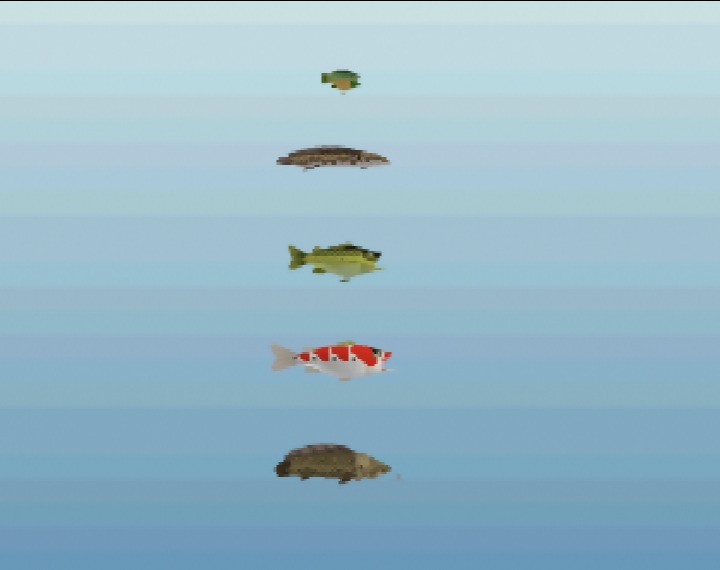

# fish-oot

**Twilight Princess-style fishing for Ocarina of Time on the N64.**

Fish swim in the overworld's ponds and rivers. Cast a bobber anywhere there's water, read the nibbles, set
the hook on the real bite, and fight the fish on a tension gauge in the style of Sega Bass Fishing. Every
species is modeled on the fish of Twilight Princess, Ocarina of Time and Breath of the Wild, and each has its
own size range, habits and favorite bait.

It ships as a `.bps` patch for your own ROM and runs on real hardware (no Expansion Pak needed) and in accurate
emulators like [ares](https://ares-emu.net/).

> **Status:** early. Kokiri Forest only for now; the fishing loop is being tuned there before any other area
> gets fish. Longer-term goals are in the [roadmap](fishmod/docs/roadmap.md).



## Playing

1. Get the newest patch from the [releases page](https://github.com/RastrumQuill/fish-oot/releases) (or build it, below).
2. Apply it to an **Ocarina of Time NTSC 1.2 (US)** ROM in big-endian `.z64` order with
   [Flips](https://github.com/Alcaro/Flips) or the [online patcher](https://www.marcrobledo.com/RomPatcher.js/).
   - Expected input MD5: `57a9719ad547c516342e1a15d5c28c3d`.
   - `.v64` / `.n64` ROMs: convert first with `python3 fishmod/tools/to_z64.py in.v64 out.z64`.
3. Play on an emulator or on a flashcart.

### Controls

| | |
|---|---|
| **The rod's C button** | Take out the rod (put it on a C button from the item page) |
| **The rod's C button** (hold, release) | Hold to charge a cast, release to throw. The stick aims |
| **A bait bottle's C button** (rod out, not cast) | Put bait on the hook |
| **A** (while the bobber flies) | Brake the line for a shorter cast |
| **Stick flick** | Twitch the bobber to draw fish in |
| **B** | Set the hook when the bobber is pulled under (not on the little nibbles!) |
| **A** / **R + A** | Reel in / reel in fast |
| **Stick** (while fighting) | Hold against the fish's run to tire it faster |
| **Z** | Zoom the camera on the bobber |

While fighting, keep the **tension** gauge in the green: too high and the line snaps, too slack and the fish
shakes the hook. Reel a tired fish in to land it.

## Fish

See the **[wiki](fishmod/wiki/README.md)** for every species with in-game renders, flavor text, size and
weight ranges, behavior and bait, plus [how the fish are modeled](fishmod/docs/modeling.md) and the
[research notes](fishmod/docs/research/README.md).

| Kokiri Forest | |
|---|---|
| Hyrule Minnow | tiny, curious, everywhere |
| Greengill | the classic first catch |
| Hyrule Bass | strikes hard, jumps |
| Sanke Carp | ornamental koi, rare |
| Ordon Catfish | bottom-dweller, night, long fights |
| Hylian Loach | legendary, very wary |

## Building

The mod is built on the [zeldaret/oot](https://github.com/zeldaret/oot) decompilation; this repository is
the decomp (imported unmodified in its first commit) with the mod's changes on top. Follow the decomp's setup
in [docs/DECOMP_README.md](docs/DECOMP_README.md) for version `ntsc-1.2` (Linux or WSL), then:

```bash
cp /path/to/your/rom baseroms/ntsc-1.2/baserom.z64   # .z64, .v64 or .n64
make setup VERSION=ntsc-1.2
fishmod/build.sh --testmode --hw                      # -> fishmod/out/fish-oot-f3dex3-test-hw.bps (console test build)
fishmod/build.sh --testmode                           # -> fishmod/out/fish-oot-test.bps (emulator test build)
```

Builds are made for a profile (`fishmod/data/profiles.json`): `hw` for the console and accurate emulators such as
ares (F3DEX3, tuned to the RDP's limits), `emu` (the default) for HLE emulators such as Project64.

`fishmod/build.sh` needs [Flips](https://github.com/Alcaro/Flips) on `PATH` (or `FLIPS=/path/to/flips`).
To check the toolchain on an unmodified tree, `make VERSION=ntsc-1.2 REGION=US rom compress` should end with
`oot-ntsc-1.2-compressed.z64: OK`.

### Development

| | |
|---|---|
| `fishmod/data/species.json` | every species: looks, sizes, behavior, bait, flavor text. `fishmod/tools/gen_species.py` and `gen_textures.py` turn it into game data and the wiki |
| `src/overlays/actors/ovl_En_Fishmod/` | the fish (`z_en_fishmod.c`), the fishing controller: rod, bobber, camera, fight (`fishmod_rod.c`), and the cached ground height under the water (`fishmod_water.c`) |
| `src/code/fishmod.c` | which scenes have fish, the rod's controller (any scene), saving, the weather |
| `fishmod/data/profiles.json` | the build profiles (`build.sh --profile emu\|hw`): draw distances, prop budgets, thinning, F3DEX3 |
| `fishmod/build.sh --debug` | debug build: boots straight into Kokiri with the rod and shows debug text |
| `fishmod/build.sh --f3dex3` | build with the [F3DEX3](fishmod/docs/f3dex3.md) graphics microcode whatever the profile says (the `hw` profile has it; HLE emulators can't run it) |
| `fishmod/build.sh --script NAME` | debug build that plays `fishmod/scripts/NAME.inc.c`: `angler` (a bot that fishes by itself), `shore` (the bot, standing back from the water), `follow` (camera chases a fish), `photo` (wiki renders), `anim` (the animation studio), `hwbench_play` / `hwbench_area` (benchmarks), `cast` |
| `fishmod/tools/photo_capture.py` | captures the wiki renders from the photo build in ares |
| `fishmod/tools/water_map.py` | maps fishable water and shore spots in a scene |
| `fishmod/tools/model_preview.py` | renders a model's limbs offline to identify parts |
| `fishmod/tools/read_stats.py` | read a debug build's timing stats (`--prof`: where fish time goes) |
| `fishmod/tools/assets.py` | new art (PNG/OBJ) into C, from `fishmod/assets/assets.json` ([docs](fishmod/docs/assets.md)) |
| `fishmod/docs/` | [roadmap](fishmod/docs/roadmap.md), plans, research and developer notes |
| `releases/` | every patch and its notes |

## Credits

- The [zeldaret](https://github.com/zeldaret) team for the Ocarina of Time decompilation. Their original
  README is in [docs/DECOMP_README.md](docs/DECOMP_README.md).
- Fish lore from Twilight Princess, Ocarina of Time and Breath of the Wild (Nintendo); fight design inspired by
  Sega Bass Fishing.
