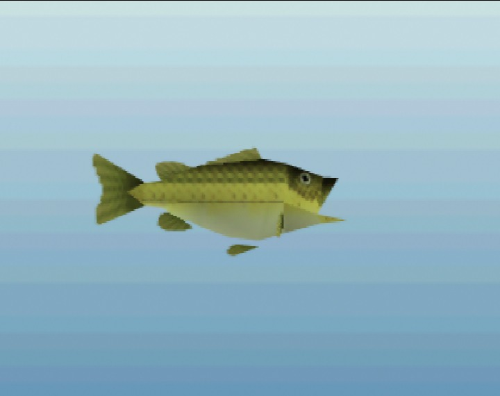

# fish-oot wiki

Twilight Princess-style overworld fishing for Ocarina of Time (N64). Pages are generated from [`fishmod/data/species.json`](../data/species.json); behavior and sizes match the game.

- [How the fish are modeled](../docs/modeling.md)
- [Research notes and sources](../docs/research/README.md)
- [Bait](baits.md)

## Fish

*Kokiri Forest fish at typical size, to scale. Top to bottom: Hyrule Minnow, Greengill, Hylian Loach, Hyrule Bass, Sanke Carp, Ordon Catfish.*

| | Fish | Rarity | Length | Where | Status |
|---|---|---|---|---|---|
|  | [Greengill](species/greengill.md) | Common | 4–16 in | Kokiri Forest, Lake Hylia | in game |
|  | [Hyrule Minnow](species/hyrule_minnow.md) | Common | 2–7 in | Kokiri Forest | in game |
|  | [Hyrule Bass](species/hyrule_bass.md) | Uncommon | 8–24 in | Kokiri Forest, Lake Hylia | in game |
|  | [Ordon Catfish](species/ordon_catfish.md) | Rare | 10–28 in | Kokiri Forest, Lake Hylia | in game |
|  | [Hylian Loach](species/hylian_loach.md) | Legendary | 8–36 in | Kokiri Forest, Lake Hylia | in game |
|  | [Sanke Carp](species/sanke_carp.md) | Very rare | 10–26 in | Kokiri Forest, Lake Hylia | in game |
|  | [Hylian Pike](species/hylian_pike.md) | Rare | 14–40 in | Lake Hylia, Zora's River | planned |
|  | [Reekfish](species/reekfish.md) | Legendary | 10–22 in | Zora's Domain | planned |
|  | [Hearty Bass](species/hearty_bass.md) | Very rare | 12–30 in | Lake Hylia | planned |
|  | [Jabu-Jabu Fry](species/jabu_fry.md) | Legendary | 6–14 in | Zora's Fountain | planned |
