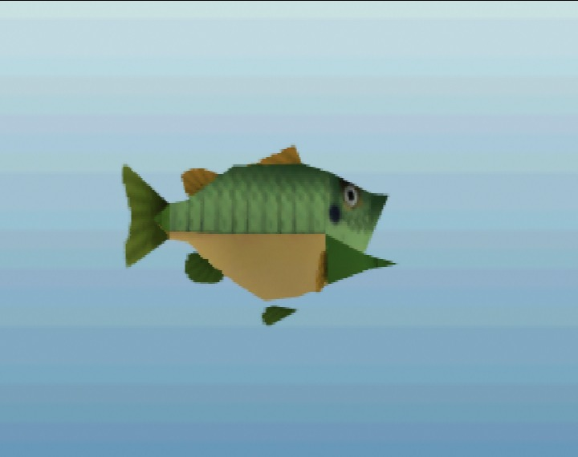
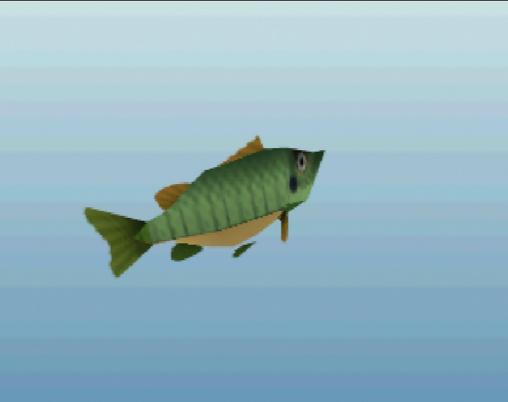

# Greengill

*Common · from Twilight Princess · In game*

 

*In-game renders at a typical size (7 in), captured in ares.*

> A small, bright fish found in almost every pond and creek in Hyrule. It nibbles at anything that drifts by, which makes it the first catch of many young anglers.

## Stats

| | |
|---|---|
| Length | 4–16 in (typically ~7 in) |
| Weight | 1 oz – 4.1 lbs |
| Rarity | Common (1/5) |
| Sell price | 5 rupees (more for bigger fish) |
| Depth | mid |
| Most active | day, dusk |
| Found in | Kokiri Forest |

## Behavior

```
curiosity  ████████░░ 80
aggression ███████░░░ 70
wariness   ██░░░░░░░░ 25
strength   ██░░░░░░░░ 25
stamina    ███░░░░░░░ 30
speed      ████░░░░░░ 45
jumpiness  █░░░░░░░░░ 10
nibbles    2 before the real bite
bite window18 frames (0.90 s) to set the hook
```

## Bait

| Bait | Interest |
|---|---|
| Bare hook | ×1.0 |
| Bee Larva | ×1.6 |
| Bug | ×1.4 |
| Worm | ×1.5 |

## Tips

Bites readily, even without bait. Taps the bobber a couple of times before it commits.

[← All fish](../README.md)
