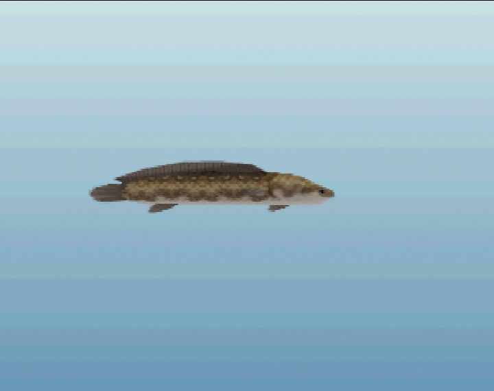
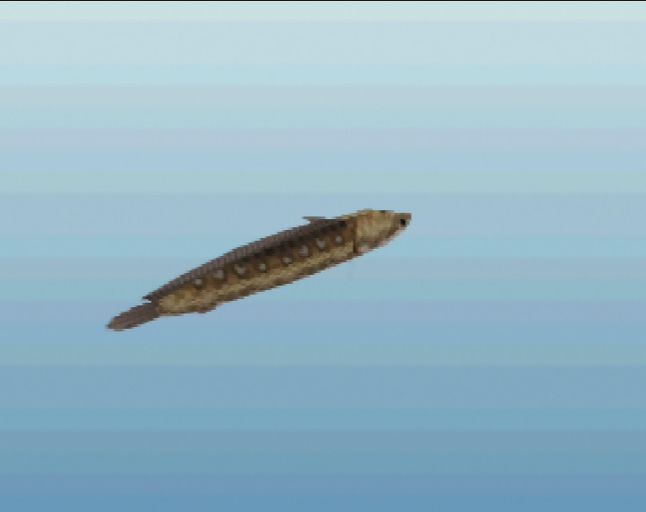

# Hylian Loach

*Legendary · from Ocarina of Time (Fishing Pond), Twilight Princess · In game*

 

*In-game renders at a typical size (12 in), captured in ares.*

> A long, spotted bottom-dweller that anglers whisper about. Young loaches turn up in quiet forest water now and then; the giants of legend are rarely seen anywhere.

## Stats

| | |
|---|---|
| Length | 8–36 in (typically ~12 in) |
| Weight | 2 oz – 14.0 lbs |
| Rarity | Legendary (5/5) |
| Sell price | 150 rupees (more for bigger fish) |
| Depth | bottom |
| Most active | dawn |
| Found in | Kokiri Forest, Lake Hylia (planned) |

## Behavior

```
curiosity  ██░░░░░░░░ 20
aggression ███░░░░░░░ 30
wariness   ████████░░ 85
strength   ███████░░░ 70
stamina    █████████░ 90
speed      ██████░░░░ 55
jumpiness  ░░░░░░░░░░ 5
nibbles    4 before the real bite
bite window10 frames (0.50 s) to set the hook
```

## Bait

| Bait | Interest |
|---|---|
| Bare hook | ×0.2 |
| Bee Larva | ×0.8 |
| Bug | ×1.2 |
| Worm | ×1.0 |

## Tips

Extremely wary: cast well away from it and keep still. It nibbles a lot and the real bite is short.

[← All fish](../README.md)
