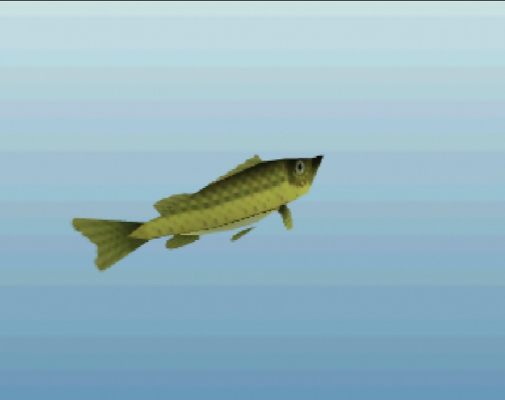

# Hyrule Bass

*Uncommon · from Twilight Princess, Ocarina of Time (Fishing Pond) · In game*

 

*In-game renders at a typical size (13 in), captured in ares.*

> The classic Hylian game fish. It hunts from cover and strikes hard, and the big ones are known to leap clear of the water to throw the hook.

## Stats

| | |
|---|---|
| Length | 8–24 in (typically ~13 in) |
| Weight | 5 oz – 8.6 lbs |
| Rarity | Uncommon (2/5) |
| Sell price | 20 rupees (more for bigger fish) |
| Depth | mid |
| Most active | dawn, day, dusk |
| Found in | Kokiri Forest, Lake Hylia (planned) |

## Behavior

```
curiosity  ██████░░░░ 55
aggression ██████░░░░ 65
wariness   █████░░░░░ 50
strength   ██████░░░░ 60
stamina    ██████░░░░ 55
speed      ██████░░░░ 65
jumpiness  ████░░░░░░ 45
nibbles    1 before the real bite
bite window14 frames (0.70 s) to set the hook
```

## Bait

| Bait | Interest |
|---|---|
| Bare hook | ×0.8 |
| Bee Larva | ×1.3 |
| Bug | ×1.6 |
| Worm | ×1.4 |
| Spinner | ×1.5 |
| Crankbait | ×1.4 |
| Popper | ×1.3 |
| Frog Lure | ×1.3 |
| Sinking Lure | ×1.5 |

## Tips

Most active around dawn and dusk. A twitched bobber or a live bug draws it out. Expect a jump when it is hooked.

[← All fish](../README.md)
