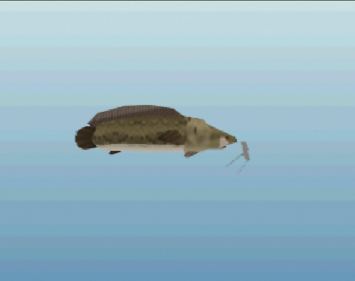
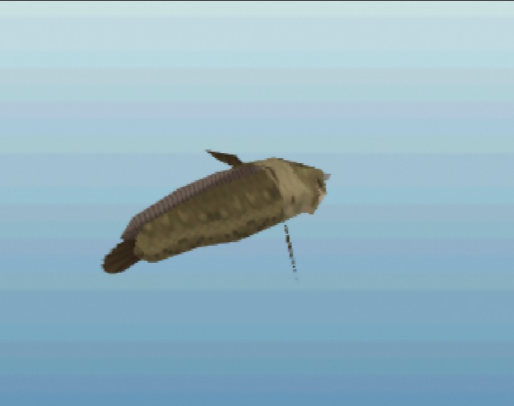

# Ordon Catfish

*Rare · from Twilight Princess · In game*

 

*In-game renders at a typical size (16 in), captured in ares.*

> A whiskered bottom-feeder first described by the villagers of Ordon. It lurks in the deepest, muddiest part of a pond and pulls like a stubborn goat once hooked.

## Stats

| | |
|---|---|
| Length | 10–28 in (typically ~16 in) |
| Weight | 6.0–131.7 lbs |
| Rarity | Rare (3/5) |
| Sell price | 40 rupees (more for bigger fish) |
| Depth | bottom |
| Most active | night, dusk |
| Found in | Kokiri Forest |

## Behavior

```
curiosity  ████░░░░░░ 40
aggression █████░░░░░ 50
wariness   ████░░░░░░ 35
strength   ████████░░ 80
stamina    ████████░░ 80
speed      ███░░░░░░░ 30
jumpiness  ░░░░░░░░░░ 0
nibbles    3 before the real bite
bite window22 frames (1.10 s) to set the hook
```

## Bait

| Bait | Interest |
|---|---|
| Bare hook | ×0.4 |
| Bee Larva | ×1.0 |
| Bug | ×0.8 |
| Worm | ×1.8 |

## Tips

Fish the deepest water after dark. It takes its time and nibbles several times before the real bite, then fights long but never jumps.

[← All fish](../README.md)
