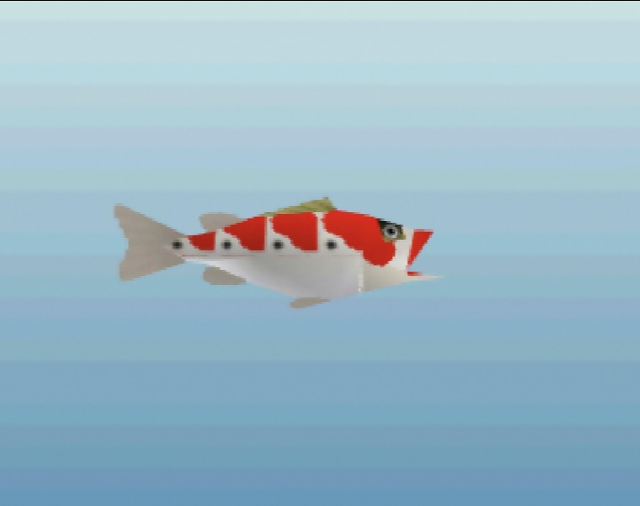
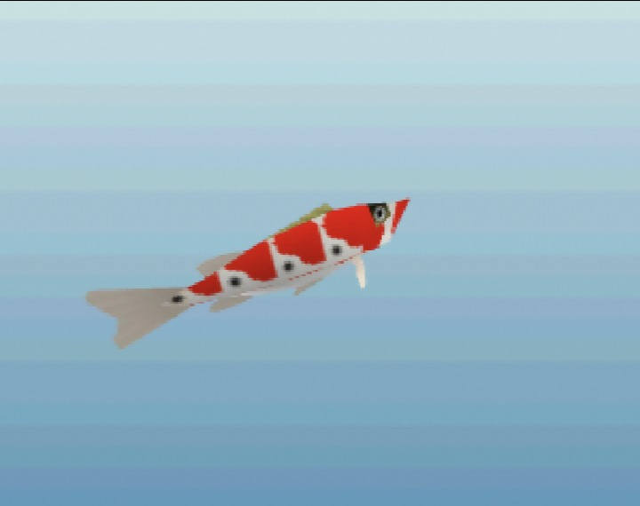

# Sanke Carp

*Very rare · from Breath of the Wild · In game*

 

*In-game renders at a typical size (15 in), captured in ares.*

> An ornamental carp with red and white markings, kept in sacred waters since ancient times. The Kokiri say they swim in the forest for luck.

## Stats

| | |
|---|---|
| Length | 10–26 in (typically ~15 in) |
| Weight | 14 oz – 15.8 lbs |
| Rarity | Very rare (4/5) |
| Sell price | 80 rupees (more for bigger fish) |
| Depth | surface |
| Most active | day |
| Found in | Kokiri Forest, Lake Hylia (planned) |

## Behavior

```
curiosity  ███████░░░ 70
aggression ██░░░░░░░░ 25
wariness   ████░░░░░░ 40
strength   ████░░░░░░ 45
stamina    █████░░░░░ 50
speed      ████░░░░░░ 35
jumpiness  ██░░░░░░░░ 15
nibbles    3 before the real bite
bite window16 frames (0.80 s) to set the hook
```

## Bait

| Bait | Interest |
|---|---|
| Bare hook | ×0.3 |
| Bee Larva | ×1.8 |
| Bug | ×0.7 |
| Worm | ×0.9 |

## Tips

Cruises near the surface on bright days. Curious, but picky: sweet bee larvae work best.

[← All fish](../README.md)
